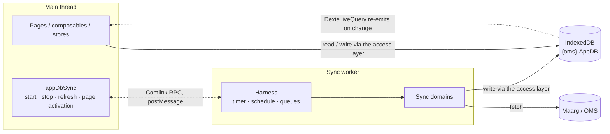
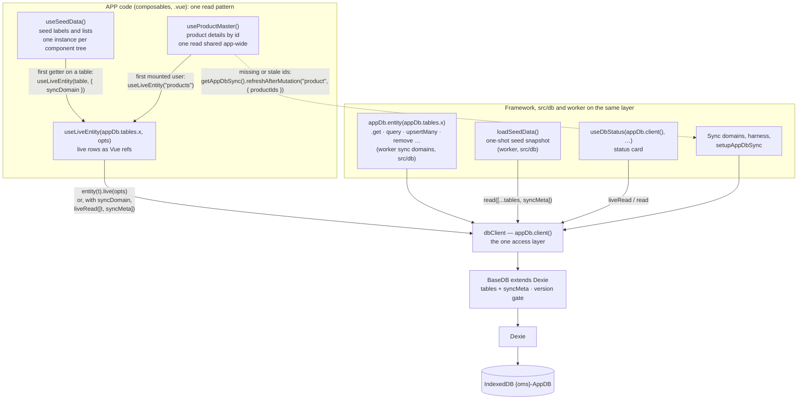
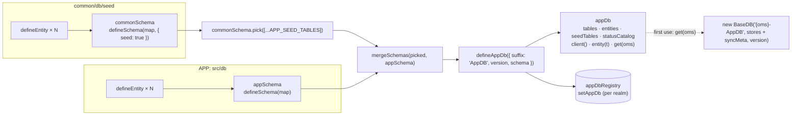
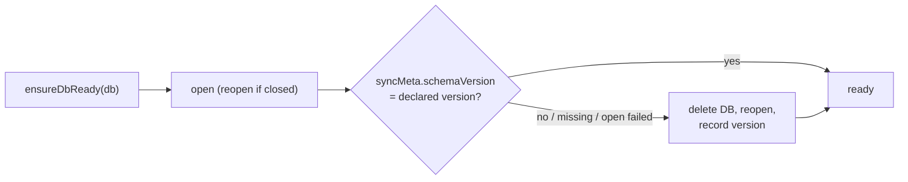
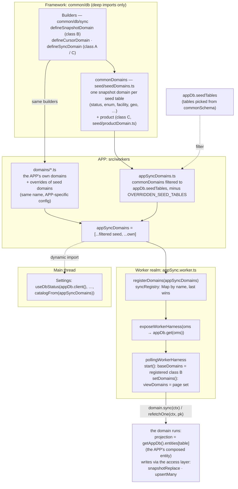
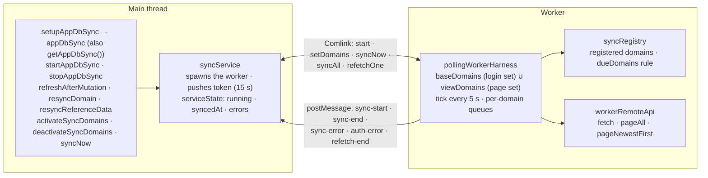

# AccxUI Local Database & Sync — Architecture

**Version:** 2.2 · **Date:** 2026-10-16

How the APP's local database is built and reached: the Dexie database, the access layer on top of
it, how the schema is prepared, what a sync domain is, and the runtime that fills the tables. The
lifecycle (login, one-time sync, mutation, page sync, logout) is in
[APP_DB_SYNC_FLOWS.md](APP_DB_SYNC_FLOWS.md). Recipes and rules:
[APP_DB_DEVELOPER_GUIDE.md](APP_DB_DEVELOPER_GUIDE.md).

Framework code is in `common/db/`. Names used for the APP:

| Name | In the APP |
|---|---|
| `appSchema` | `src/db/appSchema.ts`: the APP's own entities |
| `appDb` | `src/db/appDb.ts`: the APP's database object (`defineAppDb(...)`) |
| `{oms}-AppDB` | The IndexedDB database: OMS instance + the APP's `suffix` |
| `appSyncDomains` | `src/workers/appSyncDomains.ts`: every sync domain the APP registers |
| `appSync.worker.ts` | `src/workers/appSync.worker.ts`: the sync worker entry |
| `appDbSync` | `src/db/appDbSync.ts`: the APP's `setupAppDbSync(...)` facade |

---

## 1. Overview

The APP renders from a **local IndexedDB mirror** of OMS data. A **sync worker** fills it from
Maarg; the **main thread** reads it. One database per OMS instance, so tenants never share rows.



Two JavaScript realms share the database. The worker re-evaluates every module it imports, so it
has its own copy of `appDb`, the domain registry and the app-db registry. It gets the OMS instance
from `start()` and the auth token by push over a `BroadcastChannel`. Nothing the worker imports
may pull in `vue`, `commonUtil` or the `@common/db` barrel, so worker-side modules use deep imports.

---

## 2. Access layer: from Dexie up to the APP

Nothing above `dbClient` touches Dexie. Every read and write, on the main thread and in the
worker, goes down this one stack.



`useSeedData()` and `useProductMaster()` have no database path of their own: every table they open
is a `useLiveEntity` read (for a seed table, with the seed domain's login marker read in the same
transaction, `synced`). `useProductMaster()` never writes either: it asks the worker's `product`
domain for the ids it lacks, and the live read shows them once stored. APP code reaches the
database only through these.

| Layer | Role | Key facts |
|---|---|---|
| **BaseDB** | `Dexie` subclass for one database | Adds the `syncMeta` store; `ensureDbReady` opens it and runs the version gate (§3.4); `retainedTables` lists the `retainOnLogout` tables the logout wipe skips |
| **appDb.client() / dbClient** | The one access layer, as the APP sees it | `defineAppDb` builds ONE `dbClient` from a resolver, so it resolves the signed-in OMS instance on every call and follows an instance switch. Every operation passes `ensureDbReady` first. Writes store only the entity's declared `fields` (coerced, plus `syncedAt`); a row missing a key member is dropped. `appDb.get(oms)` (raw handle) is for the worker entry only |
| **useLiveEntity** | Vue form of `entity(t).live(opts)` | Returns `{ records, first, count, hydrated, synced, error }` refs; with `syncDomain` it reads that domain's login marker with the rows (`synced`); re-subscribes when options change; unsubscribes when its scope ends |
| **useSeedData** | Seed lookups over `useLiveEntity` | One `useLiveEntity(table, { syncDomain })` per seed table, opened by the first getter that needs it, shared by the component tree, closed when the providing component unmounts |
| **useProductMaster** | Product details over `useLiveEntity("products")` | One live read for the whole app, opened by the first mounted user, closed when the last unmounts. `getProduct(id)` answers from it and batches the ids whose row is missing or older than `PRODUCT_STALE_MS` into one `refreshAfterMutation("product", { productIds })`, through the sync `setupAppDbSync` registered (`getAppDbSync()`) |
| **appDb.entity** | One-shot `EntityClient` | Plain async calls, for worker sync domains (the only writers) and `src/db`; app code does not use it |
| **loadSeedData** | One-shot seed snapshot | Same getters as `useSeedData`, read once in one transaction; `src/workers/**` and `src/db/**` only |

### 2.1 The read pattern

```ts
import { useLiveEntity } from "@common";
import { appDb } from "@/db/appDb";

// App code: live, in a composable or .vue file, during setup
const { records, first, hydrated } = useLiveEntity<any>(
  appDb.tables.facilities,
  () => ({ equals: { facilityId: props.facilityId } }),   // function → re-subscribes on change
);

// Worker sync domains only: one-shot reads and the table's writes
const facilities = appDb.entity(appDb.tables.facilities);
await facilities.upsertMany(rows);
```

Stores, utils and the router never read the app db: they take rows from the composable or page
that calls them, and a page or domain composable joins store data with `useLiveEntity` rows.

- **Query options** (the same for `useLiveEntity` and `appDb.entity`): `scope` / `equals` (equalities, resolved through the widest
  matching index), `dateField` + `since` / `until` / `order` (newest first by default), `filter`,
  `limit`.
- **`hydrated`** is true once the first emission arrived and either rows exist or no sync is
  running. It tells "not loaded yet" from "really empty". With `syncDomain`, **`synced`** is the
  stricter answer: the domain's login marker was read with the rows.
- **Seed lookups** (`useSeedData()` during setup, in a composable or `.vue` file): the first
  `useSeedData()` in a component tree provides one live read per seed table (through
  `useLiveEntity`, with its domain's login marker), opened on first use and shared by every
  component below it, closed when that component unmounts; never in `App.vue`. Label getters
  (`facilityName(id)`), list getters with `.withSync()` (is the empty list real?), async `get*`
  getters. A store action or util that needs seed rows takes them as arguments.
- **Table names** always come from `appDb.tables.x`: typed, static, work in the worker and before
  sign-in.

### 2.2 Enforced by lint

The root `eslint.config.js` rejects any other path in APP code, using core ESLint rules
(`no-restricted-syntax`, `no-restricted-imports`, `@typescript-eslint/no-restricted-imports`). The
APP's `eslint.config.js` spreads the exported `dbConfig` (these data-access and layer rules), and the
APP's build runs it before `vite build` (`eslint src && vite build`), so a violation fails the build:

| Not allowed | Use instead |
|---|---|
| `import … from "dexie"` | `useLiveEntity` |
| `dbClient`, `getAppDb`, `ensureDbReady`, `BaseDB` value imports | `useLiveEntity` |
| a string table name | `appDb.tables.x` |
| `appDb.entity(...)` or `loadSeedData()` outside `src/workers/**` and `src/db/**` | `useLiveEntity` / `useSeedData` in a composable or `.vue` file |
| `useLiveEntity` / `useSeedData` / an app composable outside composables and `.vue` files | the caller passes the rows |
| `.live()` / `.liveRead()` in the sync worker | a one-shot `appDb.entity(...)` read |
| an app db module imported in a store; a store imported in a util, `src/db` or a worker | a page or domain composable joins them |
| `api` / `client` imported outside composables, stores and worker domains | the composable or store action that owns the request |
| `activateSyncDomains` with no `deactivateSyncDomains` in the file, or in a page with no `onIonViewDidLeave` | deactivate with the same owner on leave |
| `deactivateSyncDomains()` with no owner | `deactivateSyncDomains(SYNC_OWNER)` |
| `appDb.get(oms)` outside `src/db/**` and the worker entry | `useLiveEntity` |
| `appDb.client()` outside `src/workers/**` and `useDbStatus(...)` | `useLiveEntity` |
| a write on `appDb.entity(...)` outside `src/workers/**` | `refreshAfterMutation` / `resyncDomain` |

---

## 3. Schema preparation

One declaration per entity and one per APP. The Dexie store strings, table names and status catalog
are all derived from them.



### 3.1 `defineEntity`: one table

```ts
widgets: defineEntity({
  primaryKey: "widgetId",                     // "a,b" for a compound key → Dexie [a+b]
  fields: {                                   // the ONLY fields stored (a whitelist)
    widgetId: "text", statusId: "text", lastUpdatedStamp: "date",
  },
  indexes: ["statusId", "[statusId+lastUpdatedStamp]"],
  rename: { widgetName: "name" },             // stored name ← server field name
  // keyDefaults: { feedId: "" },             // stand-in for a key member the server may omit
  // retainOnLogout: true,                    // keep rows on logout: same data for every user (products)
}),
```

Field kinds: `text` (trimmed string), `count` (number), `date` (epoch millis), `structured`
(passed through). Validation runs **at import time**: an index or key on an undeclared field
throws, so a bad declaration fails on load instead of leaving an empty index.

`retainOnLogout: true` keeps a table's rows when logout empties the database ([flows §7](APP_DB_SYNC_FLOWS.md#7-logout-and-teardown)).
Only for data that is the same for every user of the OMS instance, such as the `products` master;
never for anything scoped to the signed-in user. It survives `extendEntities`, and a `version` bump
still drops the rows.

### 3.2 `defineSchema` and its combinators

- `defineSchema(map)` keys entities by IndexedDB store name.
- `pick(tables)`: a subset (throws on an unknown table).
- `mergeSchemas(...)`: combines schemas (throws if two claim one table).
- `extendIndexes(map)`: adds indexes, re-validated.
- `extendEntities(map)`: adds fields, indexes and renames to entities of any schema (seed or not),
  the APP-side way to widen an entity it did not declare. Additive only: it throws on a field already declared or a rename
  that already exists, and the primary key and `keyDefaults` stay as declared. Sync domains project
  through the APP's composed entity, so added fields are stored with no domain change. Bump `version`.

  ```ts
  commonSchema.pick(["facilities"]).extendEntities({
    facilities: { fields: { externalId: "text" }, indexes: ["externalId"], rename: { externalId: "externalFacilityId" } },
  })
  ```
- `seedTables` records which tables came from `commonSchema`. It is tracked by origin, not by name,
  because the APP may declare its own table with a seed table's name.

### 3.3 `defineAppDb`: the APP's database

```ts
// src/db/appDb.ts — deep imports only (the worker imports this file)
export const appDb = defineAppDb({
  suffix: "AppDB",
  version: 1,                 // bump for ANY schema change
  schema: mergeSchemas(commonSchema.pick([...APP_SEED_TABLES]), appSchema),
});
appDb.setOmsInstanceResolver(() => "default");   // test fallback; main.ts registers the real one
```

Nothing is opened at import. The database `{oms}-AppDB` is created on first use, when `client()`
resolves the signed-in instance. Switching instance closes the old handle and opens a different
database.

### 3.4 Version gate and `syncMeta`



No migrations: the local data is a re-derivable copy, so a version mismatch drops and rebuilds the
database and the worker refills it. **A forgotten bump is not detected**, so bump `version` as part
of every schema change.

`syncMeta` (added by `BaseDB`) holds:

| Key | Meaning |
|---|---|
| `schemaVersion` | The version this database was built for. Survives logout. |
| `loginSync:{domain}` | The domain completed its one-time sync for this login |
| `domain:{domain}` | Optional per-domain stamp the APP writes; the status card prefers it |

---

## 4. Sync domains

A **domain** says how one table is filled from the server: `{ name, table, label, syncClass,
intervalMs?, sync(ctx, args), refetchOne?(ctx, pk, args) }`. The name is what
`refreshAfterMutation(name, pk)` and page activation refer to.

| Class | Data | Built with | Runs | Writes |
|---|---|---|---|---|
| **B** | Reference / config | `defineSnapshotDomain` | Once per login, then on mutation or manual refresh | `snapshotReplace`: upsert + prune, one transaction |
| **A** | Live, append-mostly (logs, job runs, messages) | `defineCursorDomain` or hand-written `defineSyncDomain` | Every `intervalMs`, only while a page activates it | `upsertMany` of rows newer than the stored cursor; never prunes |
| **C** | On request only (the `product` master) | `defineSyncDomain` with a `refetchOne` | Never ticked; only when `refreshAfterMutation(name, pk)` asks | via `refetchOne` |

```ts
// Class B: whole set, replaced
defineSnapshotDomain({
  name: "widget", label: "Widgets", syncClass: "B", table: "widgets",
  listUrl: "oms/widgets", collectionKey: null,
  byPk: (pk) => ({ url: `oms/widgets/${pk.widgetId}` }),      // how refreshAfterMutation re-reads one
});

// Class A: only what is newer than the stored cursor
defineCursorDomain({
  name: "widgetEvent", label: "Widget events", table: "widgetEvents", intervalMs: 15_000,
  listUrl: "oms/widgetEvents", cursorField: "createdDate", cursorParam: "createdDate_from",
  scopeOf: (args) => ({ field: "productStoreId", value: args.productStoreId }),
});
```

**Refetch strategies** (used after a mutation), checked in this order on a snapshot domain:

| Strategy | When | Effect |
|---|---|---|
| `fanOut` | child rows exist only under a parent (per product store) | re-list that parent's children, replace that slice |
| `byPk` | a `GET /thing/{id}` route exists | upsert the one record, or remove it if gone |
| `refetchScope` | no by-id route, but the list filters by id | re-list that slice, replace it |
| none | | nothing happens: use `resyncDomain(name)` |

### 4.1 How the APP's domain list is built

Domains come from two places: the framework's seed domains and the APP's own. The APP composes
one list, `appSyncDomains`; the worker registers exactly that list, and the main thread reads the
same module for the status card, so the two never disagree.



- **Framework domains are definitions, not registrations.** Importing `commonDomains` runs
  nothing; a domain runs only once the APP's list puts it in the registry. A seed table the APP
  did not pick has no domain registered, and a domain that is not registered never runs, with no
  error. The `product` domain is in `commonDomains` too, so an APP that picks the `products` table
  gets it through the same filter.
- **Overrides win on name.** An APP domain registered under a seed domain's name replaces it,
  because the registry is a `Map` and the APP's own domains come after the filtered seed ones. The
  table is listed in `OVERRIDDEN_SEED_TABLES` so the seed version is not registered at all.
- **Projection follows the APP's schema.** A seed domain resolves its entity through
  `getAppDb().entities[table]` when it runs, so fields the APP added with `extendEntities` are
  stored with no domain change.

In code:

```ts
// src/workers/appSyncDomains.ts
const appSeedDomains = Object.values(commonDomains)
  .filter((d) => d.table && appDb.seedTables.has(d.table) && !OVERRIDDEN_SEED_TABLES.has(d.table));
export const appSyncDomains = [...appSeedDomains, ...appOwnDomains];

// src/workers/appSync.worker.ts
registerDomains(appSyncDomains);
exposeWorkerHarness((omsInstance) => {
  appDb.setOmsInstanceResolver(() => omsInstance);   // APP domains use appDb.entity(...)
  return appDb.get(omsInstance);
});
```

A seed table the APP fills differently keeps its table from `commonSchema.pick(...)`; the APP
registers its own domain under the seed domain's name and lists the table in
`OVERRIDDEN_SEED_TABLES`. A domain that is not registered never runs, with no error.

---

## 5. Sync runtime



| Piece | Owns |
|---|---|
| `setupAppDbSync` | What the APP imports, via `appDbSync`. One service per login; the page's activated set; error scoping (`syncDomainsError`). Registers itself, so framework composables (`useProductMaster`) reach it through `getAppDbSync()` |
| `syncService` | The worker's lifecycle (idempotent start, generation guard against late messages), token push, the reactive `serviceState` |
| `pollingWorkerHarness` | The one timer; two domain sets; which domains are due; running them one at a time; queueing a refetch against a sync of the same domain |
| `syncRegistry` | The domain map and the pure scheduling rule: no interval means due only if never run; an interval means due when it has elapsed |

The flows that use these pieces (login, one-time sync, mutation, page sync, logout) are in
[APP_DB_SYNC_FLOWS.md](APP_DB_SYNC_FLOWS.md).

---

## 6. File map

The APP's folder structure, with what each file must contain, is in
[APP_DB_DEVELOPER_GUIDE.md §9](APP_DB_DEVELOPER_GUIDE.md#9-app-folder-structure).

| Layer | Framework (`common/db/`) | APP (`src/`) |
|---|---|---|
| Schema | `schema/defineEntity.ts`, `schema/defineSchema.ts`, `seed/seedSchema.ts` | `db/appSchema.ts` |
| Database | `schema/defineAppDb.ts`, `schema/appDbRegistry.ts`, `storage/baseDb.ts` | `db/appDb.ts` |
| Access | `storage/dbClient.ts`, `storage/projection.ts` | — |
| Read surface | `composables/useLiveEntity.ts`, `useSeedData.ts`, `useProductMaster.ts`, `useDbStatus.ts` | pages, components, composables; `views/Settings.vue` |
| Domains | `sync/defineSnapshotDomain.ts`, `defineCursorDomain.ts`, `defineSyncDomain.ts`, `cachedEntity.ts`, `seed/seedDomains.ts`, `seed/productDomain.ts` | `workers/domains/*.ts`, `workers/appSyncDomains.ts` |
| Worker runtime | `sync/pollingWorkerHarness.ts`, `sync/syncRegistry.ts`, `core/workerRemoteApi.ts` | `workers/appSync.worker.ts` |
| Main-thread runtime | `sync/syncService.ts`, `sync/setupAppDbSync.ts`, `sync/channels.ts`, `sync/reconciliation.ts` | `db/appDbSync.ts`, `main.ts`, `App.vue`, `store/user.ts` |
