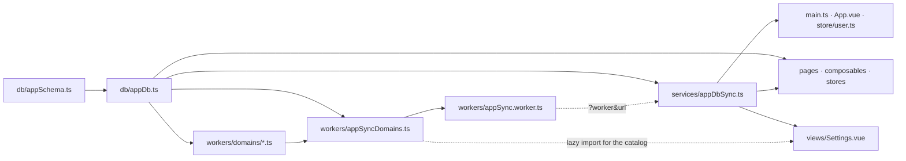

# Using the Local Database — Developer Guide

**Audience:** app developers working in `apps/*`.
**Architecture:** [APP_DB_ARCHITECTURE.md](APP_DB_ARCHITECTURE.md) (structure) ·
[APP_DB_SYNC_FLOWS.md](APP_DB_SYNC_FLOWS.md) (flows).
**Last updated:** 2026-10-13 — checked against the current `common/db`; app-neutral names (`appDb`, `appSchema`, `{oms}-AppDB`).

This is the how-to. It answers "I need X on screen — what do I write?", for a generic **APP**: its
database object is `appDb` (`src/db/appDb.ts`), its own entities are `appSchema`
(`src/db/appSchema.ts`), and its database is `{oms}-AppDB`. Read the architecture doc for the big picture; read this to get work done.

---

## 0. What you get out of the box

Your app declares its tables once, and the framework gives you:

- **One IndexedDB database per OMS instance**, named `{omsInstance}-{suffix}`. Switching tenant
  lands on a different database; you never have to filter by instance.
- **A background sync worker** that fills those tables on its own thread, on its own cadence, with
  the bearer token kept fresh.
- **Reactive reads** — your view re-renders when rows change, whether the change came from the
  worker or from your own write-through.
- **29 HotWax seed reference tables** (statuses, enums, facilities, geos, carriers, shipment
  methods, …) already declared and already synced. You pick which ones you want.

The rule of thumb: **read from the database, never fetch reference data in a view.**

---

## 1. Choosing a data API

App code reaches the database one way — through `dbClient`, with one query shape (`QueryOptions`) —
in **two patterns, picked by need**:

| You want… | Use | Where it works |
|---|---|---|
| Rows that stay current **on screen** (§1b) | `useLiveEntity(table, options?)` | Components and composables, during `setup` |
| An answer **now**, or a **write** (§1d) | `appDb.entity(table)` — `get`, `getMany`, `all`, `query`, `first`, `count`, `put`, `bulkPut`, `upsertMany`, `snapshotReplace`, `remove`, … | Anywhere: stores, services, async handlers, composables, the worker |
| Live updates **outside a component** (rare) | `appDb.entity(table).live(options)` — a Dexie `Observable`; keep the subscription and unsubscribe it (§1e) | Stores, services, utils. **Not** setup code (use `useLiveEntity`) and **not** the worker |

`appDb` is the APP's database object (`src/db/appDb.ts`). `all()` followed by a JS
`filter` / `find` is fine.

Two conveniences sit on the same layer and are not separate data paths:

| You need | Use | Shape |
|---|---|---|
| A label, option list or joined lookup for seed data | `useSeedData()` in components; `seedData` in stores and utils | `seed.facilityName(id)` in a template or `computed` |
| Row counts + last-sync per domain (Settings) | `useDbStatus(appDb.client(), catalog, actions)` | `{ domains, totalRows, refreshAll, … }` |

**Not for pages or stores** — framework and worker internals:

| You want… | Use | Who uses it |
|---|---|---|
| Snapshot reads across several tables; sync login markers | `appDb.client()` — `read`, `liveRead`, `syncedThisLogin`, `markSyncedThisLogin`, `clearSyncedThisLogin` | Framework internals (`useSeedData`, `useDbStatus`, `setupAppDbSync`) and hand-written worker sync domains |

**Name tables through `appDb.tables`.** Every schema carries its table names as a static object —
`commonSchema.tables`, `appSchema.tables`, and the composed `appDb.tables` (the seed tables
the app picked plus its own). It is plain data built when the module loads, with no database
involved, so it works in the worker and before sign-in:

```ts
useLiveEntity<any>(appDb.tables.facilities, () => ({ equals: { facilityTypeId } }));
await appDb.entity(appDb.tables.statuses).all();
```

A misspelled name is a missing property, so it fails to compile — including in `useLiveEntity`,
which otherwise takes any string. `appDb.entity(table)` and every table-taking `appDb.client()`
method also check a literal name against the app's tables, and `useLiveEntity` checks at runtime
(§1b). For a helper that takes a table, type the parameter as `AppDbTables<typeof appDb>`.

Rows are not typed from the schema yet: `entity(...)` rows are `Record<string, any>` and
`useLiveEntity` rows are what you pass it (`<any>` at most call sites). Stronger row typing is
planned as a separate effort.

There is no raw Dexie handle on an app database: nothing outside `common/db` touches Dexie.

### 1a. `useSeedData()` — seed lookups

Typed getters over the framework seed tables: labels, option lists and in-memory joins. It takes no
arguments and resolves the active database itself. The APP may wrap it in its own lookup composable.

Each seed table is one Dexie `liveQuery`, opened the first time any getter needs it and kept until
sync stops (logout, or the stop at the start of a login). Every caller shares that one read, so a
table is read once per session, and the query re-emits whenever the table changes: the login sync
filling it, a `refreshAfterMutation`, or a resync from Settings. A table nobody asks for is never
read. There is no init step.

Getters come in two kinds, told apart by name:

| Kind | Names | Returns | Use it for |
|---|---|---|---|
| Reactive | no prefix: `statusDescription`, `facilityName`, `enumsByType`, `countries`, `shipmentMethodOptions`, `partyRelationshipTypes`, `allowedTransitions`, … | a value, synchronously | templates and `computed`s |
| Async | `get` prefix: `getFacilities`, `getGeos`, `getProductStores`, `getEnumsByType`, … | a Promise of the table's rows once its first local read lands | code that must act on the rows, such as building a request from them |

```ts
import { useSeedData } from "@common/db";

const seed = useSeedData();

// Reactive: call it where the value is shown. It re-renders when the table loads or changes.
const channels = computed(() => seed.enumsByType("ORDER_SALES_CHANNEL"));
const states = computed(() => seed.statesForCountry(form.countryGeoId));  // geos ⋈ geoAssocs
```

```vue
<ion-label>{{ seed.statusDescription(item.statusId) }}</ion-label>
<ion-note>{{ seed.facilityName(item.facilityId) }}</ion-note>
```

```ts
// Async: only when the rows must be in hand before continuing.
const facilityRows = await seed.getFacilities();
const facilityIds = facilityRows.filter(isPhysicalFacility).map((facility) => facility.facilityId);
```

**In stores, services and utils, use `seedData`, not `useSeedData()`.** It is the same getter set as
a plain object, and it reads the same shared tables, so it answers exactly what the composable does.
Pinia stores never call a composable:

```ts
import { seedData } from "@common/db";

const parentTypeId = seedData.facilityType(seedData.facility(facilityId)?.facilityTypeId)?.parentTypeId;
```

**Don't resolve seed data into a ref.** There's no need for `watch` + `await` + a label-map `ref`:
the reactive getter already re-renders on its own, and a watcher only adds a raw-id flash and a race
between out-of-order reads.

**A cold table answers with the raw id or `[]`.** The first render after a table's first use shows
the id (or an empty list) until the read lands, a few milliseconds later, then re-renders. On a
fresh login the table may also still be empty because the background sync hasn't filled it yet.

**When an empty list drives a decision, use `.withSync()`.** Every list getter has it, with the
same arguments, and it answers `{ data, synced }`. `synced` turns true once the tables behind the
getter hold this login's sync (it reads the domain's `loginSync:` marker in the same transaction as
the rows), so an empty `data` with `synced` true really is empty:

```ts
// An address form: "no states" only once geos have synced (SG, HK have none).
const countryStates = computed(() => seed.statesForCountry.withSync(form.countryGeoId));
const isLoadingStates = computed(() => !!form.countryGeoId && !countryStates.value.synced);
```

`synced` stays false if that domain's sync fails, so a screen that must not spin forever also
accepts "first read landed and `serviceState.running` is false".

**The async `get*` getters wait for the first local read, not for the sync.** Use them when the rows
must be in hand before you continue, such as code that stamps a looked-up value permanently
(for example, building an address state from `await getGeos()`). On a fresh
login they can still resolve `[]`, so they do not tell "not synced yet" from "empty". Use
`.withSync()` or `useLiveEntity`'s `hydrated` for that.

Label getters accept a missing id (`undefined` or `null`) and answer `""`; list getters answer `[]`.
Countries come from `geoTypeEnumId === "GEOT_COUNTRY"`; a country's states follow its `GAT_REGIONS`
associations only, so group memberships such as DBIC never appear as states.

`allowedTransitions(statusId, statusFlowId?)` reads one status flow, `Default` unless you name
another, as OMS does for an order with none. Flows reuse status ids, so reading every flow would mix
their transitions. Rows come in `transitionSequence` order with `toStatusDescription` added, and
carry `transitionName` and `conditionExpression`.

### 1b. `useLiveEntity()` — reactive reads

One entry point, always a list, backed by a Dexie `liveQuery`. The APP's read composables over its
own tables are built on it; seed lookups go through `useSeedData` instead.

Pick `useSeedData` for read-only seed lookups: labels, dropdown options, names by id. Pick `useLiveEntity`
when the screen queries a table (`equals`, `scope`, `filter`, a date range), needs `hydrated` for
its loading and empty states, or reads one of the app's own tables. Each `useLiveEntity` call is its own
subscription, closed on unmount; `useSeedData`'s are shared and live for the session.

```ts
import { useLiveEntity } from "@common";
import { appDb } from "@/db/appDb";

// Whole table, live.
const { records, hydrated } = useLiveEntity<any>(appDb.tables.statuses);

// One row: `equals` on the primary key is an index lookup, and `first` is the row.
const { first: facility, hydrated } = useLiveEntity<any>(appDb.tables.facilities, () => ({ equals: { facilityId: props.id } }));

// A scoped slice.
const { records } = useLiveEntity<any>(appDb.tables.productStoreFacilities, { scope: { field: "productStoreId", value: id } });
```

Pass a **function** when the options depend on reactive state — it re-subscribes when they change,
and until the new query's first emit `records` is empty and `hydrated` is false, so store A's rows
never render under store B. Pass a plain object when they're static.

For a single-row read whose id may not be known yet, return `{ filter: () => false }` rather than
`{}` while it is missing: `{}` reads the whole table, and `first` would be some other row.

`useLiveEntity(table, options?)` reads the signed-in app database through `getAppDb().client()`;
`useLiveEntity(client, table, options?)` reads another database through its `DbClient` (a raw `BaseDB` is
still accepted and wrapped).

It is the Vue form of `appDb.entity(table).live(options)`, hence the name. A table the database
does not have throws at the call — `[db] useLiveEntity: "facilitys" is not a table in
OMS-AppDB.` — rather than surfacing only in `error`. (It was called `useDb` until 2026-10-12.)

`QueryOptions`:

- `scope` and `equals` are one set of equalities (`scope` is just the first), and every one holds on
  the result. The read uses the widest declared index that covers them: `[scope+…equals+dateField]`,
  then `[scope+…equals]`, then the first indexed field. Whatever the index can't cover is filtered
  in memory, and with no usable index the whole table is read. Matching is strict `===`, so a number
  never matches a string.
- `dateField` **orders** the result, newest first unless `order: "asc"`; `since`/`until` bound it.
- `filter` (in-memory predicate), then `limit`, applied after sorting, so `dateField` + `limit` is
  "the latest N".
- `order` defaults to `"desc"` with a `dateField`, otherwise storage order.

> **`hydrated`, not `records.length`.** `hydrated` is false while the first sync is still running, so
> use it to tell "not loaded yet" from "genuinely empty". Rendering an empty state off
> `records.length === 0` will flash it on every cold start.

### 1c. `useDbStatus()` — the Settings card

```ts
import { catalogFrom, useDbStatus } from "@common/db";

const { domains, totalRows, lastSyncedAt, refreshDomain, refreshAll } = useDbStatus(
  appDb.client(),
  // Every domain the APP registers, loaded lazily so the domain modules stay out of the page chunk.
  async () => catalogFrom((await import("@/workers/appSyncDomains")).appSyncDomains),
  { resyncDomain, resyncAll: resyncReferenceData },
);
```

Build the catalog from `appSyncDomains`, not from the worker (`syncService()?.catalog()`): the card
then lists every domain even before the worker is up or after it failed to start, when its
per-domain Refresh is the way back. `appDb.statusCatalog` exists too, but it lists only the seed
tables' common domains, not the APP's own or overridden ones.

Actions are injected rather than imported, because the card must refresh through the same service
that owns your app's worker.

### 1d. `appDb.entity()` — one-shot reads and writes

For an answer **now**, or a **write**: stores, services, async handlers, cache-first lookups and
the worker's sync domains. Plain async calls — nothing re-renders afterwards; use `useLiveEntity`
for that. Every call resolves the signed-in database, so a client held in a module-scope const
follows an OMS switch.

```ts
import { appDb } from "@/db/appDb";

const facilities = appDb.entity(appDb.tables.facilities);

const one = await facilities.get(facilityId);                           // by primary key
const some = await facilities.query({ equals: { facilityTypeId } });    // same QueryOptions as useLiveEntity
const all = await facilities.all();                                     // then filter / find in JS — fine
await facilities.upsertMany([fetchedRow]);                              // write-through after a fetch
```

`first`, `count`, `getMany`, `put`, `bulkPut`, `remove`, `snapshotReplace` and the rest are on the same
`EntityClient`. Writes project through the entity, so pass the server's record as-is. After a
mutation on the server, reconcile through `refreshAfterMutation` (§4) rather than writing the
response yourself. For live updates outside a component, see §1e.

### 1e. Manual live subscriptions (rare)

`useLiveEntity` owns its subscription: it subscribes, re-subscribes when the options change and
unsubscribes on unmount. Anything else that calls `.live()` owns its subscription too, and a leaked
one keeps re-running its query on every write until the page reloads. So:

- **Setup code** (`.vue`, `src/components`, `src/views`, `src/composables`): never call `.live()` or
  `.liveRead()`. Use `useLiveEntity`.
- **The sync worker** (`src/workers/**`): no live queries at all. It writes and renders nothing; read
  once with `appDb.entity(...).get / query / all`.
- **Stores, services, utils:** allowed, but keep the subscription and unsubscribe it in the same
  teardown that runs on logout, as `useSeedData` does in `clearSeedTables()`:

```ts
import { appDb } from "@/db/appDb";

let facilitiesSub: { unsubscribe(): void } | null = null;

export function watchFacilities(onRows: (rows: any[]) => void) {
  facilitiesSub?.unsubscribe();
  facilitiesSub = appDb.entity(appDb.tables.facilities).live({}).subscribe({ next: onRows });
}

/** Call from the logout teardown, next to stopAppDbSync(). */
export function stopWatchingFacilities() {
  facilitiesSub?.unsubscribe();
  facilitiesSub = null;
}
```

Lint enforces the first two, and that a subscription's handle is kept (§7). It cannot check that
`unsubscribe()` is actually called, so that part is for review.

---

## 2. Adding a table to your app

Four steps. Miss the last one and existing installs keep the old row shape.

**1. Declare the entity.** In your app's schema module (`src/db/appSchema.ts`):

```ts
widgets: defineEntity({
  primaryKey: "widgetId",              // comma-separate for a compound key: "productStoreId,widgetId"
  fields: {                            // THE WHITELIST — see the warning below
    widgetId: "text",
    widgetName: "text",
    statusId: "text",
    lastUpdatedStamp: "date",
  },
  indexes: ["statusId", "lastUpdatedStamp", "[statusId+lastUpdatedStamp]"],
  rename: { widgetName: "name" },      // stored name ← the field the API actually sends
}),
```

`FieldKind` picks the coercion: `text` → trimmed string, `count` → number, `date` → epoch millis
(accepts millis, numeric string or ISO), `structured` → passed through as-is (an empty array stays `[]`).

A row missing **any** primary-key member is dropped as unkeyable. If the server legitimately omits
a key member (a document attached to no feed), give it a stand-in with `keyDefaults: { feedId: "" }`.
Each key in `keyDefaults` must be a primary-key field. Use it only where the absence is a real state,
never to cover a wrong field name.

> ⚠️ **`fields` is a whitelist, and it is the only thing stored.** A field you don't declare is
> dropped at write time — it is not tucked away anywhere. If a screen needs it, declare it. This is
> the single most common cause of "the row is in IndexedDB but my field is undefined".

**2. Add an index for every way you query it.** A `scope`, `equals` or `dateField` with no index
still works, but it reads the whole table and filters or sorts in memory. A two-part question ("this
store's widgets, newest first") wants a compound index `[productStoreId+createdDate]`, not two single-field
ones: the read then comes back filtered and ordered from the index alone.

**3. Bump the version** in your app's db module:

```ts
export const appDb = defineAppDb({
  suffix: "AppDB",
  version: 4,                          // ← was 3
  schema: mergeSchemas(commonSchema.pick([...APP_SEED_TABLES]), appSchema),
});
```

**4. Give it a domain** so something fills it — §3.

The new table is then on `appDb.tables` (and `appSchema.tables`) with nothing more to do:
name it as `appDb.tables.widgets` wherever you read or write it (§1).

### Why the version bump is not optional

A database recording a different version than the build declares is **dropped and rebuilt** on first
use, and the worker refills it. That is the only migration mechanism: there is no in-place upgrade.

Bump it for *any* schema change — new table, added or removed index, changed primary key, changed
`fields`, changed `rename` or `keyDefaults`. **Nothing detects a forgotten bump.** The app will run, and rows written
by the previous build will still be there with their old shape — a `date` field still holding an ISO
string, a renamed field still absent. Treat bumping as part of the change, not a step afterwards.

### Picking seed tables

Take only what you read:

```ts
const APP_SEED_TABLES = ["productStores", "statuses", "enums", "facilities", /* … */] as const;
mergeSchemas(commonSchema.pick([...APP_SEED_TABLES]), appSchema)
```

To take every seed table, pass `commonSchema` itself. Picking seven gives seven tables, not all of
them.

Two ways to fill a seed table differently from the framework:

- **Same table, your own domain.** Pick the seed table, and register a domain with the seed domain's
  **name** and your endpoint, leaving the seed one out of `registerDomains`. For example, an APP
  that wants `statuses` from `oms/statuses` instead of the seed `admin/status` picks the seed table,
  registers its own `{ name: "status", listUrl: "oms/statuses" }`, and filters the seed `status`
  domain out of its `workers/appSyncDomains.ts` list (keep an `OVERRIDDEN_SEED_TABLES` set there).
  Build the status card from that same list (§1c), so it shows the domain that actually runs.
- **Your own table under a seed name.** Declare it in your own schema and don't `pick` the seed one.
  The framework tracks provenance, so `appDb.statusCatalog` leaves it out instead of pointing it at
  the seed endpoint.

---

## 3. Filling a table: pick a sync class

| Class | Meaning | Cadence | Use |
|---|---|---|---|
| **B** | Reference / config. Rarely changes. | Once per login, then only on mutation | `defineSnapshotDomain` |
| **A** | Live, append-mostly. Transactional. | `intervalMs`, only while a view needs it | `defineCursorDomain`, or hand-written |
| **C** | Write-through only. | Never polled | hand-written |

**Class B — the common case.** Fetch the whole set, replace what's stored:

```ts
defineSnapshotDomain({
  name: "widget",                  // registry name — what refreshAfterMutation() calls
  label: "Widgets",                // shown on the status card
  syncClass: "B",
  table: "widgets",
  listUrl: "oms/widgets",
  collectionKey: null,             // null = bare array; "widgetList" = resp.widgetList
  byPk: (pk) => ({ url: `oms/widgets/${encodeURIComponent(String(pk.widgetId))}` }),
})
```

`collectionKey` is explicit on purpose — the envelope differs per endpoint, and guessing is how a
snapshot silently becomes `[]`. Add `strictCollection: true` to fail loudly instead of degrading.

**Class A — live data.** A cursor domain fetches only what's newer than what you hold:

```ts
defineCursorDomain({
  name: "widgetEvent",
  label: "Widget events",
  table: "widgetEvents",
  intervalMs: 15_000,
  listUrl: "oms/widgetEvents",
  cursorField: "createdDate",       // the stored field that advances
  cursorParam: "createdDate_from",  // the server param that lower-bounds it
  total: 100,                       // window depth per scope
  scopeOf: (args) => (args.productStoreId ? { field: "productStoreId", value: args.productStoreId } : undefined),
})
```

⚠️ **Probe the endpoint before trusting a cursor param.** Filter support is per-route, not a Moqui
convention. `admin/dataManager/details` honours `_from` but ignores `_op`; `admin/systemMessages`
ignores both and silently returns the unfiltered page. If the server ignores your param the `keep`
predicate still trims client-side, but you pay for the full page every tick.

**Then register it** in your worker entry (`src/workers/appSync.worker.ts`):

```ts
registerDomains(appSyncDomains);   // src/workers/appSyncDomains.ts: [...appSeedDomains, widgetDomain, /* … */]
```

A domain that isn't registered never runs, with no error. Add a test (for example
`tests/db/domainTables.spec.ts`) asserting every registered domain's table is declared in `appDb`.

---

## 4. Keeping the database fresh after a write

Mutations go to the server first, then you reconcile the local row. Never write the server's
response into the table yourself.

```ts
import { refreshAfterMutation } from "@/services/appDbSync";

const response = await api({ url: "oms/widgets", method: "post", data: { widgetId, widgetName } });
// ...check the response however your APP does (for example a local `hasError` helper)
// and only reconcile once the write is known to have landed:
await refreshAfterMutation("widget", { widgetId });   // domain name + primary key
```

`refreshAfterMutation` throws `CacheReconciliationError` when the server change landed but the local
refresh didn't. **That is not a failed mutation** — it carries `mutationCommitted = true`, so don't
retry the write. Show "saved, but refresh to see it" and let the user reload.

Which refetch strategy your domain needs:

| Situation | Config |
|---|---|
| A `GET /thing/{id}` route exists | `byPk` |
| That route wraps the record differently from the list | `byPk` + `byPkRecordKey: "jobDetail"` |
| No by-id route, but the list filters by id | `refetchScope` |
| The stored row is (parent, child) and the mutation only knows the parent | `refetchScope` — a plain upsert would leave the old child row behind |
| None of `byPk`, `refetchScope` or `fanOut` configured | **Nothing happens.** `refreshAfterMutation` resolves `0` and the row stays stale. Add one, or call `resyncDomain(name)` instead |

Check the seed domain before relying on it. Of the seed domains, only `productStore` and `facility`
(`byPk`), `enum` and `groupFacility` (`refetchScope`), and the `fanOut` ones (`productStoreFacility`,
`productStoreFacilityGroup`, `productStoreShipmentMethod`, which re-read every row for the
`productStoreId` in the key) reconcile after a mutation. `enum` refetches by its
`enumId` (`refreshAfterMutation("enum", { enumId })`); `status`, `geo`, `carrier` and the other
type tables don't, so after mutating one of those use `resyncDomain`.

A `byPk` read that fails rejects, so it surfaces as `CacheReconciliationError` rather than a silent
stale row. A `byPk` route may answer with the record itself or a one-item list; an empty answer
removes the stored row.

---

## 5. Polling while a view is open (class A)

Class-A domains are off by default. A view switches on what it reads, with args, and switches them
off when it leaves. The three functions come from your app's `services/appDbSync.ts`, which
re-exports them from `setupAppDbSync`:

```ts
import { activateSyncDomains, createSyncDomainOwner, deactivateSyncDomains } from "@/services/appDbSync";

// Once per screen instance, at setup — never a shared constant.
const SYNC_OWNER = createSyncDomainOwner("widgetView");

const widgetSyncDomains = () => [
  { name: "widgetEvent", intervalMs: 15_000, args: { productStoreId: props.id } },
  { name: "widgetRun", intervalMs: 60_000, args: { productStoreId: props.id } },
];

// Ionic lifecycle, not onMounted — a cached page re-enters without remounting.
onIonViewWillEnter(() => { void activateSyncDomains(widgetSyncDomains(), SYNC_OWNER); });
// Re-scope when the thing the domains are scoped to resolves or changes.
watch(() => props.id, () => { void activateSyncDomains(widgetSyncDomains(), SYNC_OWNER); });
onIonViewDidLeave(() => { void deactivateSyncDomains(SYNC_OWNER); });
```

`activateSyncDomains` is idempotent, so call it again whenever the set changes. There is no
separate "update" call.

**Why the owner.** Ionic fires the old view's `didLeave` *after* the new view's `willEnter`. The
owner lets `deactivateSyncDomains` recognise that the leaving view no longer holds the worker, and
ignore the call, instead of wiping the domains the new view just switched on. For this to work:

- create the owner **once per instance** with `createSyncDomainOwner(label)`, inside `setup`. A
  module-level constant would be shared by every instance of the component, which defeats the
  guard when two routes reuse one component;
- pass the **same** owner to every `activateSyncDomains` and `deactivateSyncDomains` call on that
  screen;
- always deactivate in `onIonViewDidLeave`, not only in `onUnmounted` / `onBeforeUnmount`: Ionic
  keeps a page mounted when the user navigates on from it, so an unmount-only teardown leaves its
  domains polling behind a hidden page;
- don't re-activate from a `watch` while the page is hidden: gate it on a flag set in `willEnter` and
  cleared in `didLeave`, or the hidden page takes the worker back from the one on screen.

Lint checks the wiring it can see: a file that activates must also deactivate, a page (`.vue`) that
activates must register `onIonViewDidLeave`, and `deactivateSyncDomains()` always takes the owner
(§7). A composable that activates exposes a `deactivate()`, and the page calls it on leave.

**What the screen can read back:**

| From `services/appDbSync` | Use |
|---|---|
| `syncDomainsReady` | `Ref<boolean>` — the worker has accepted this activation |
| `syncDomainsError` | `ComputedRef<string>` — an error from one of the *activated* domains, else `""`. Drive the screen's warning banner from this |
| `syncNow()` | Force a pass over **this screen's** activated domains (a "refresh" button). Not the login seed set, and it clears no markers. Called mid-pass, it queues a fresh pass instead of resolving against the running one |
| `serviceState.syncedAt[domain]` (from `@common/db`) | When that domain last finished a pass **for its current activation**. Use it to tell "nothing for this store" from "not fetched yet". It is removed when the screen leaves or re-scopes the domain, and cleared on logout |

**One screen, one set.** There is one worker and one active set. If two features on one screen
both need polling, build one combined list and activate it once (a shared composable can own that list). Two separate `activateSyncDomains` calls overwrite each other. The login set (class
B) is separate: it stays active alongside whatever a screen activates, and a screen can't switch it
off.

An activation that runs before the sync has started (a deep link lands before `App.vue` starts it)
is held and handed to the worker when it comes up, so the screen doesn't lose its set.

`syncNow()` is the screen's refresh. Settings' "Refresh all" is `resyncReferenceData()`: it clears
every sync marker, then forces a pass over every active domain, login set and screen set together
(`syncService()?.syncAll()` underneath).

Two rules that matter:

- **Pass only what this screen renders.** Args multiply into requests — six message types across two
  remotes is twelve requests per tick, most for a screen nobody is looking at.
- **Scope, don't window.** "The newest 100 system messages" caches whatever happens to be recent,
  which is usually not what your screen needs. Declare a scope (this store, this config)
  so the window is about your data. Keep that policy in one place, such as `src/config/appSyncConfig.ts`.

Leaving the view stops the polling but keeps the rows, so a revisit paints instantly.

---

## 6. Standing up a database for a new app

Seven steps. The resulting folder structure, and what each file must contain, is in §9.

```ts
// 1. src/db/appSchema.ts — the APP's own entities (§2). DEEP imports only.
import { defineEntity } from "@common/db/schema/defineEntity";
import { defineSchema } from "@common/db/schema/defineSchema";

export const appSchema = defineSchema({
  widgets: defineEntity({ primaryKey: "widgetId", fields: { widgetId: "text", statusId: "text" }, indexes: ["statusId"] }),
});
```

```ts
// 2. src/db/appDb.ts — DEEP imports only, never "@common/db" (the worker reaches this file)
import { defineAppDb } from "@common/db/schema/defineAppDb";
import { mergeSchemas } from "@common/db/schema/defineSchema";
import { commonSchema } from "@common/db/seed/seedSchema";
import { appSchema } from "./appSchema";

const APP_SEED_TABLES = ["productStores", "statuses", "enums", "facilities"] as const;

export const appDb = defineAppDb({
  suffix: "AppDB",
  version: 1,
  schema: mergeSchemas(commonSchema.pick([...APP_SEED_TABLES]), appSchema),
});
appDb.setOmsInstanceResolver(() => "default");          // test fallback; main.ts replaces it
```

```ts
// 3a. src/workers/appSyncDomains.ts — every domain the APP registers (worker-safe imports)
import { commonDomains } from "@common/db/seed/seedDomains";
import { appDb } from "@/db/appDb";
import { widgetDomain } from "./domains/widgetDomain";

const appSeedDomains = Object.values(commonDomains).filter((d) => d.table && appDb.seedTables.has(d.table));
export const appSyncDomains = [...appSeedDomains, widgetDomain];

// 3b. src/workers/appSync.worker.ts — registration happens here
import { exposeWorkerHarness } from "@common/db/sync/pollingWorkerHarness";
import { registerDomains } from "@common/db/sync/syncRegistry";
import { appDb } from "@/db/appDb";
import { appSyncDomains } from "./appSyncDomains";

registerDomains(appSyncDomains);
exposeWorkerHarness((omsInstance) => {
  appDb.setOmsInstanceResolver(() => omsInstance);   // APP domains use appDb.entity(...)
  return appDb.get(omsInstance);
});
```

```ts
// 4. src/services/appDbSync.ts — the main-thread facade (barrel import is fine here)
import { createSyncService, setupAppDbSync } from "@common/db";
import { appDb } from "@/db/appDb";
import workerUrl from "@/workers/appSync.worker.ts?worker&url";

export const {
  startAppDbSync, stopAppDbSync, refreshAfterMutation,
  resyncDomain, resyncReferenceData, syncService, bootstrapState,
  // Only if the app has class-A domains (§5):
  activateSyncDomains, deactivateSyncDomains, createSyncDomainOwner,
  syncDomainsReady, syncDomainsError, syncNow,
} = setupAppDbSync({ db: appDb, getWorkerUrl: () => new URL(workerUrl, import.meta.url), createSyncService });
```

```ts
// 5. src/main.ts — register the real resolver, keeping commonUtil out of the worker chunk
appDb.setOmsInstanceResolver(() => commonUtil.getOMSInstanceName());
```

```ts
// 6. src/App.vue — start on login. WATCH, don't check once.
watch(useAuth().isAuthenticated, (authed) => { if (authed) void startAppDbSync() }, { immediate: true });
```

```ts
// 7. src/store/user.ts — stop and clear at the start of postLogin, and again on logout
async postLogin() {
  // A session that expired silently never ran postLogout, so its rows and once-per-login
  // markers are still there. Clear them before anything reads, then start fresh.
  await stopAppDbSync().catch((error) => logger.error("Failed to clear the local database on login", error));
  // ... profile, permissions ...
  void startAppDbSync();
},
async postLogout() {
  await stopAppDbSync().catch(() => { /* never block logout on cleanup */ });
},
```

`stopAppDbSync` closes the seed live queries and empties every table, but keeps the
`schemaVersion` record, so the next login doesn't rebuild the database.

The worker registers its own resolver (step 3b) because the APP's hand-written domains reach the
database through `appDb.entity(...)`, which resolves the instance per call. An APP whose domains are
all factory-built can pass `appDb.get(omsInstance)` straight through without it.

---

## 7. Rules that will bite you

**Never import `@common/db` (the barrel) from anything the worker reaches.** It re-exports modules
that import `vue`, and Vite must emit the worker chunk as a single iife. Use deep imports in your db
module, your schema module, and every domain file. The barrel is fine in components, composables and
`services/appDbSync.ts`.

Deep imports follow the folder layout of `common/db`:

| Folder | What you import from it | Worker-safe |
|---|---|---|
| `@common/db/types` | `DbRow`, `DbKey`, `FieldKind`, `SyncContext`, `SyncDomain` | yes |
| `@common/db/schema/*` | `defineEntity`, `defineSchema` / `mergeSchemas`, `defineAppDb`; `appDbRegistry` is framework-only | yes |
| `@common/db/storage/*` | `projection` (`toMillis`, `canonicalKey`, …); from `dbClient` / `baseDb`, **types only** (`EntityClient`, `BaseDB`) in app code | yes |
| `@common/db/seed/*` | `seedSchema` (`commonSchema`), `seedDomains` (`commonDomains`) | yes |
| `@common/db/sync/*` | `defineSyncDomain`, `defineSnapshotDomain`, `defineCursorDomain`, `syncRegistry`, `pollingWorkerHarness` | yes, except `syncService` and `setupAppDbSync` |
| `@common/db/composables/*` | `useLiveEntity`, `useSeedData`, `useDbStatus` | **no** — main thread only; import them from the barrel |

**App code uses the two patterns, and the build checks it.** Reads and writes go through
`useLiveEntity` and `appDb.entity(...)`, with table names from `appDb.tables`; there is no raw handle
on an app database. The rules live in the root `eslint.config.js`, built from core rules: imports
through `@typescript-eslint/no-restricted-imports`, calls through `no-restricted-syntax`. The root
file also exports `dbConfig`: the local-database rules plus no `api` / `client` imports in `.vue`
files, with the parsers they need. The APP's
`eslint.config.js` spreads `dbConfig`, and its build runs that lint first
(`"build": "eslint src && vite build"`), so a data-access violation fails `pnpm --filter <app> build`.
Editors show the same errors as you type. Every data-access message ends with "See
docs/APP_DB_DEVELOPER_GUIDE.md §7".

An "app db" is any identifier ending in `Db` (`appDb`, `companyDb`, …).

| Rule | Rejects | Where |
|---|---|---|
| `@typescript-eslint/no-restricted-imports` | value imports of `dexie`, `@common/db/storage/dbClient` / `baseDb`, `@common/db/schema/appDbRegistry`, or low-level names (`dbClient`, `getAppDb`, `ensureDbReady`, `hasSyncedThisLogin`, …) from `@common` / `@common/db` | all of `src/` |
| `no-restricted-syntax` | `appDb.raw()`; a string-literal table in `appDb.entity("x")`, `useLiveEntity("x")`, `appDb.client().get("x")` or `appDb.client().liveRead(["x"])`, and the same on a client held in a variable named `…Client` (`companyClient.count("x")`); also behind `as any` | all of `src/` |
| `no-restricted-syntax` | `appDb.get(oms)` | outside `src/db/**` and `src/workers/*.worker.ts` |
| `no-restricted-syntax` | `appDb.client()`, except as the `useDbStatus` argument | outside `src/db/**` and `src/workers/**` |
| `no-restricted-syntax` | `useLiveEntity(...)` | outside `.vue` files, `src/components`, `src/views`, `src/composables` |
| `no-restricted-syntax` | `.live(...)` / `.liveRead(...)`: use `useLiveEntity` | `.vue` files, `src/components`, `src/views`, `src/composables` |
| `no-restricted-syntax` | `.live(...)` / `.liveRead(...)` at all | `src/workers/**` |
| `no-restricted-syntax` | a discarded subscription: `x.live(...).subscribe(...);` as a bare statement, or `void …subscribe(...)` | everywhere else (§1e) |
| `no-restricted-syntax` | `activateSyncDomains(...)` in a file with no `deactivateSyncDomains(...)` | all of `src/` (§5) |
| `no-restricted-syntax` | `deactivateSyncDomains()` with no owner | all of `src/` (§5) |
| `no-restricted-syntax` | `activateSyncDomains(...)` in a page with no `onIonViewDidLeave` | `.vue` files (§5) |
| `no-restricted-imports` | `import { api, client } from "@common"`: API calls belong in composables and stores | `.vue` files |

The `.vue` API rule is a separate rule from the DB selectors, so an APP still moving its page-level
API calls can switch it off alone in its own `eslint.config.js` (`"no-restricted-imports": "off"` for
`src/**/*.vue`) until they are moved.

Type-only imports are fine. There is no autofix: write `appDb.tables.x` by hand.

`no-restricted-syntax` is one rule, and flat config replaces its options per file instead of merging
them. So the root config composes the selector lists: each data-access block restates the
folder's other selectors (no `api()` in `.vue`, `use*` composable and store names). Add a new
data-access selector to the `DA_*` lists at the top of `eslint.config.js`, and check it by linting a
sample file from an app folder (`eslint --stdin --stdin-filename src/views/X.vue`). Lint rules have
no committed spec.

The APP's config, including the exemption for an APP-local Dexie store kept outside the app
database (for example a product cache):

```js
// apps/<app>/eslint.config.js
import { dbConfig } from "../../eslint.config.js"

export default [
  ...dbConfig,
  {
    files: ["src/services/productDb.ts"],   // the APP's own Dexie store
    rules: { "@typescript-eslint/no-restricted-imports": "off", "no-restricted-syntax": "off" }
  }
]
```

AI agents get the same guidance from the `accxui-data-access` skill (`.agents/skills/accxui-data-access/SKILL.md`).

**`fields` is the whitelist.** Undeclared fields are dropped. Stored rows carry the declared fields
plus `syncedAt` — nothing else. There is no `raw` copy of the server payload to fall back on.

**`refetchOne(ctx, pk, args)` takes the context first**, like `sync`. The harness holds one context
and can't tell a factory domain from a hand-written one. Get the order wrong and the failure is
silent: the domain reads its key fields off the context (all `undefined`) and fires the request with
the primary key where the token belongs — after your mutation already succeeded.

**A snapshot domain prunes.** It treats the fetched set as authoritative and deletes everything in
scope that isn't in it. The factory guards the obvious footguns (a fetch that returns rows none of
which can be keyed; an empty fetch over a populated table on an auto sync), but if you hand-write a
snapshot pass, pass `requireComplete: true` to `pageAll` (`@common/core/workerRemoteApi`) so a
truncated walk throws instead of pruning live rows. The factory itself does not set it.

**Inside `common/db`, a `liveQuery` needs an `async` querier that awaits inside it.** Dexie tracks which
tables a querier read only across the awaits of an `async` function; a plain arrow that returns a
promise loses the tracking at its first await, so the query never re-runs when the table changes.
`dbClient.live` / `liveRead` already do this; app code never writes a `liveQuery` itself.

**Bump `version` when you touch the schema.** Nothing checks it. §2.

---

## 8. Troubleshooting

| Symptom | Likely cause | Check |
|---|---|---|
| Row is there, one field is `undefined` | Field not in `fields`, or the API names it differently | Declare it, or add a `rename` |
| Scoped query returns nothing, unscoped works | The field is not in `fields`, is absent because a `rename` was needed, or holds a different type (matching is strict `===`, so `123` ≠ `"123"`) | Entity `fields` and `rename`; the stored value's type |
| Scoped or dated query is slow on a big table | No index covers it, so the whole table is read and filtered in memory | Add the field, or a compound `[scope+dateField]`, to `indexes` (and bump `version`) |
| "Latest N" shows the oldest rows | No `dateField`, so `limit` cuts storage order | Pass `dateField`; it orders newest first |
| Seed list empty on a fresh login, screen shows "none" | Read before the seed sync landed: a reactive getter or `get*` answers `[]` until then | Use the getter's `.withSync()` and wait for `synced` (§1a) |
| `refreshAfterMutation` resolves but the row is stale | The domain has no `byPk`, `refetchScope` or `fanOut`, so the refetch does nothing | §4; use `resyncDomain(name)` |
| Table stays empty, no error | Domain not registered, or the table name differs between domain and schema | Worker entry; a `domainTables.spec.ts` that checks every registered table |
| Table empty and the status card says "none" | Class-B domain never ran — check `syncMeta` for its `loginSync:` marker | Force via `resyncDomain(name)` |
| Snapshot wiped rows that still exist server-side | Envelope mis-declared, so the response unwrapped to `[]` | `collectionKey`; add `strictCollection: true` |
| Rows stop updating after switching OMS instance | A captured Dexie handle instead of the late-binding client | Use `appDb.entity()` / `appDb.client()`, never a stored `BaseDB` handle |
| Empty state flashes on every load | Rendering off `records.length` instead of `hydrated` | §1b |
| Old field shape persists after a deploy | `version` not bumped | §2 |
| Class-A domain polls but writes nothing | Server ignores the cursor param, or `keep` trims everything | Probe the endpoint; log the page size |
| `liveQuery` errors with `DatabaseClosedError` | Something held a handle across an instance switch | As above |
| Screen stops polling after navigating to it from another polling screen | The old view's `didLeave` cleared the new view's domains: an owner shared between instances, or a `deactivateSyncDomains()` call with no owner | One `createSyncDomainOwner` per instance, passed to every call (§5) |
| Domains keep polling after leaving the view | No `deactivateSyncDomains(owner)` in `onIonViewDidLeave`, or a different owner passed than the one activated | §5 |
| A banner shows another screen's sync failure | Reading `bootstrapState.errors` / `serviceState.errors` directly | Use `syncDomainsError`, which is scoped to the active set |

Useful while debugging: `bootstrapState.errors` holds the last failure per domain,
`bootstrapState.running` says whether a sync is in flight, `serviceState.syncedAt` records when each
domain last finished, and `resyncReferenceData()` clears every sync marker and re-runs the lot.

---

## 9. APP folder structure

Every file in an APP that belongs to the local database and its sync. Create exactly these; the
names are what the lint rules, the worker bundling and the other docs expect.

```text
apps/<app>/
├── src/
│   ├── db/                              ← schema + database. Worker-safe: DEEP imports only
│   │   ├── appSchema.ts                 the APP's own entities (defineEntity / defineSchema)
│   │   └── appDb.ts                     defineAppDb(...): picked seed tables + appSchema
│   ├── workers/                         ← runs in the sync worker. Worker-safe: DEEP imports only
│   │   ├── appSync.worker.ts            worker entry: registerDomains + exposeWorkerHarness
│   │   ├── appSyncDomains.ts            the list of every domain the APP registers
│   │   └── domains/
│   │       ├── <thing>Domain.ts         one APP sync domain per file (class A or B)
│   │       └── referenceDomains.ts      APP class-B domains + seed-domain overrides
│   ├── config/
│   │   └── appSyncConfig.ts             optional: polling scopes, windows, intervals
│   ├── services/
│   │   └── appDbSync.ts                 main-thread facade: setupAppDbSync(...) re-exports
│   ├── main.ts                          registers the real OMS resolver
│   ├── App.vue                          starts the sync when isAuthenticated turns true
│   ├── store/user.ts                    postLogin / postLogout → stopAppDbSync / startAppDbSync
│   └── views/Settings.vue               the status card (useDbStatus)
├── eslint.config.js                     ...dbConfig from the root; the build lints first
└── tests/db/
    ├── domainTables.spec.ts             every registered domain's table exists in appDb
    └── appSchema.spec.ts                optional: entity keys, indexes, projections
```



### `src/db/appSchema.ts`

| Contains | Rules |
|---|---|
| `export const appSchema = defineSchema({ table: defineEntity({...}), ... })`: one entry per APP-owned table, keyed by IndexedDB store name | Deep imports only (`@common/db/schema/defineEntity`, `.../defineSchema`), because the worker reaches this file. Every field a screen reads is in `fields`; an index for every way the table is queried. No `syncMeta`. Omit the file if the APP owns no tables |

### `src/db/appDb.ts`

| Contains | Rules |
|---|---|
| `APP_SEED_TABLES` (the seed tables the APP reads); `export const appDb = defineAppDb({ suffix, version, schema: mergeSchemas(commonSchema.pick([...APP_SEED_TABLES]), appSchema) })`; `appDb.setOmsInstanceResolver(() => "default")` as a test fallback | Deep imports only. Never import `commonUtil` (the real resolver goes in `main.ts`). Bump `version` with every schema change, with a one-line comment saying what changed. Nothing else in `src/` creates a database |

### `src/workers/domains/<thing>Domain.ts`

| Contains | Rules |
|---|---|
| One exported domain: `defineSnapshotDomain` (class B), `defineCursorDomain` or `defineSyncDomain` (class A). Hand-written domains hold their tables in module scope: `const widgets = appDb.entity(appDb.tables.widgets)` | Deep imports only; HTTP through `@common/core/workerRemoteApi` (`pageAll`, `pageNewestFirst`, `workerGet`), never `api()`. `refetchOne(ctx, pk, args)` takes the context first. Name the file after the domain |

`referenceDomains.ts` collects the APP's class-B domains and any seed domain it re-declares under
the seed domain's name (the "same table, your own domain" case in §2).

### `src/workers/appSyncDomains.ts`

| Contains | Rules |
|---|---|
| `OVERRIDDEN_SEED_TABLES`; `appSeedDomains` = `commonDomains` filtered to `appDb.seedTables` minus the overrides; `export const appSyncDomains: SyncDomain[] = [...appSeedDomains, ...appOwnDomains]` | Worker-safe imports only. It is the single list: the worker registers it and the status card builds its catalog from it, so the two never disagree |

### `src/workers/appSync.worker.ts`

| Contains | Rules |
|---|---|
| `registerDomains(appSyncDomains)`; `exposeWorkerHarness((oms) => { appDb.setOmsInstanceResolver(() => oms); return appDb.get(oms); })` | Nothing else. Deep imports only, never the `@common/db` barrel (it pulls in `vue`). The only file besides `src/db/**` allowed to call `appDb.get(...)` |

### `src/services/appDbSync.ts`

| Contains | Rules |
|---|---|
| `setupAppDbSync({ db: appDb, getWorkerUrl: () => new URL(workerUrl, import.meta.url), createSyncService })` with `import workerUrl from "@/workers/appSync.worker.ts?worker&url"`, and re-exports: `startAppDbSync`, `stopAppDbSync`, `refreshAfterMutation`, `resyncDomain`, `resyncReferenceData`, `syncService`, `bootstrapState`; for page-level sync also `activateSyncDomains`, `deactivateSyncDomains`, `createSyncDomainOwner`, `syncDomainsReady`, `syncDomainsError`, `syncNow` | Main thread only; the `@common/db` barrel is fine here. Call `setupAppDbSync` exactly once (this module). Every other file imports sync functions from here, never from `@common/db/sync/*` |

### `src/config/appSyncConfig.ts` (optional)

The APP's polling policy in one place: which scopes and per-type windows a class-A domain uses, and
default `intervalMs` values. Imported by domains and by pages that build their activation lists.

### Boot and auth files

| File | Adds |
|---|---|
| `src/main.ts` | `appDb.setOmsInstanceResolver(() => commonUtil.getOMSInstanceName())` |
| `src/App.vue` | `watch(useAuth().isAuthenticated, (on) => { if (on) void startAppDbSync() }, { immediate: true })` |
| `src/store/user.ts` | `postLogin`: `await stopAppDbSync()` first, then `void startAppDbSync()` after profile and permissions. `postLogout`: `await stopAppDbSync()` |
| `src/views/Settings.vue` | `useDbStatus(appDb.client(), async () => catalogFrom((await import("@/workers/appSyncDomains")).appSyncDomains), { resyncDomain, resyncAll: resyncReferenceData })` |

### Everywhere else

Pages, composables and stores never add files to this structure. They use the two patterns:
`useLiveEntity(appDb.tables.x, ...)` and `appDb.entity(appDb.tables.x)`, plus `useSeedData` /
`seedData`, `refreshAfterMutation` and the page-activation functions from `services/appDbSync.ts`.
The APP's build lints it first (§7).
