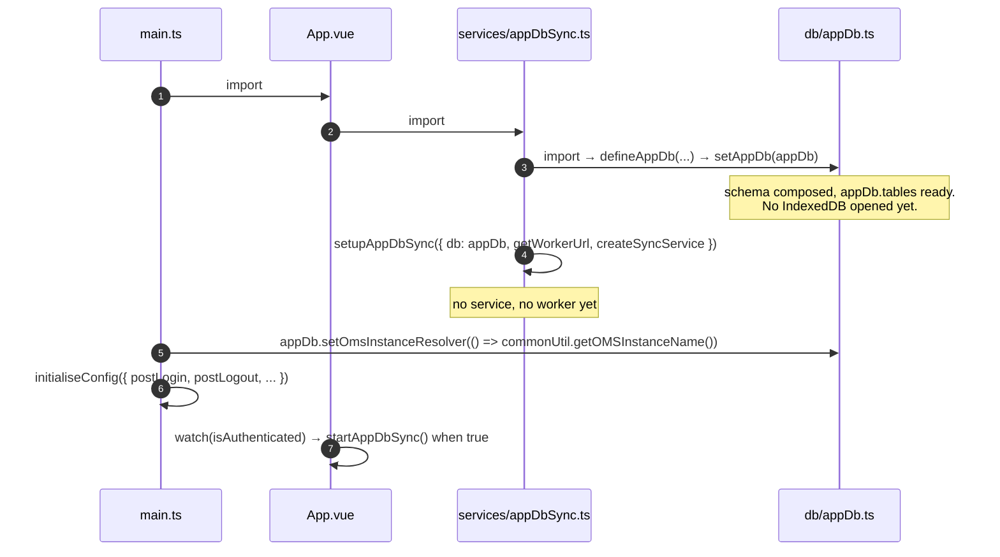
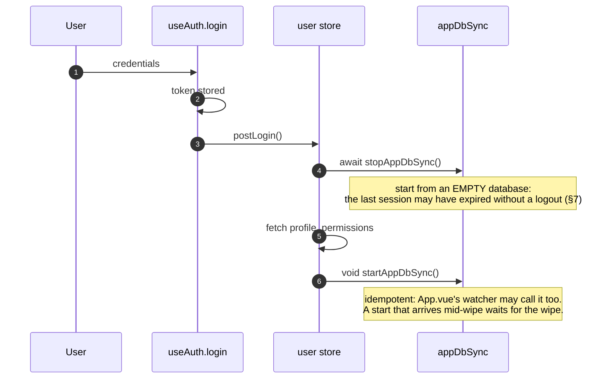
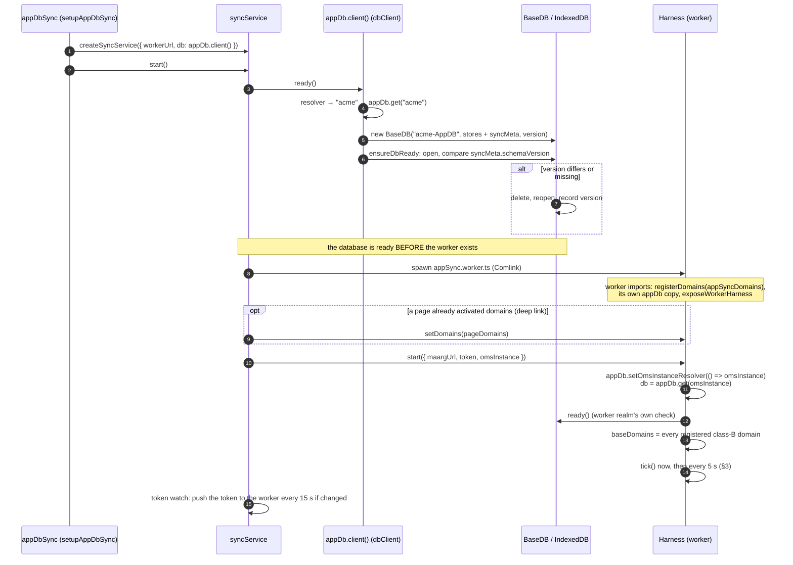
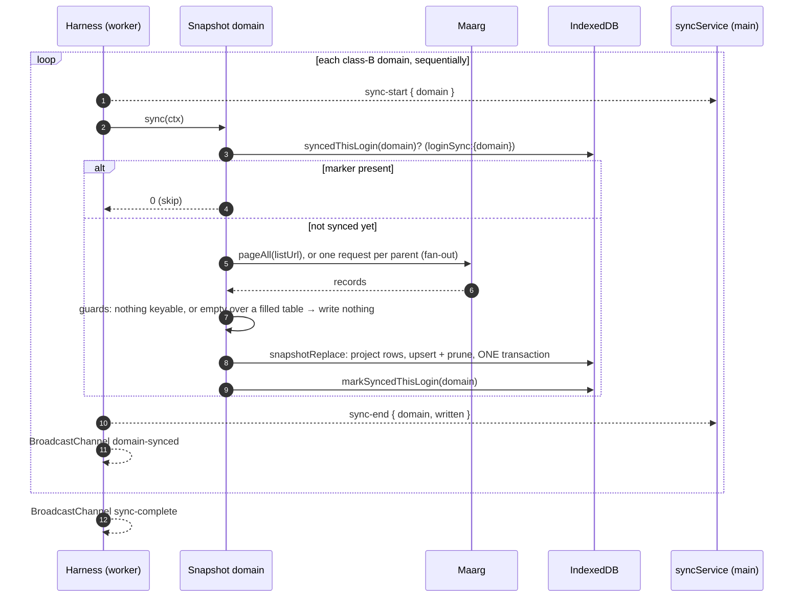
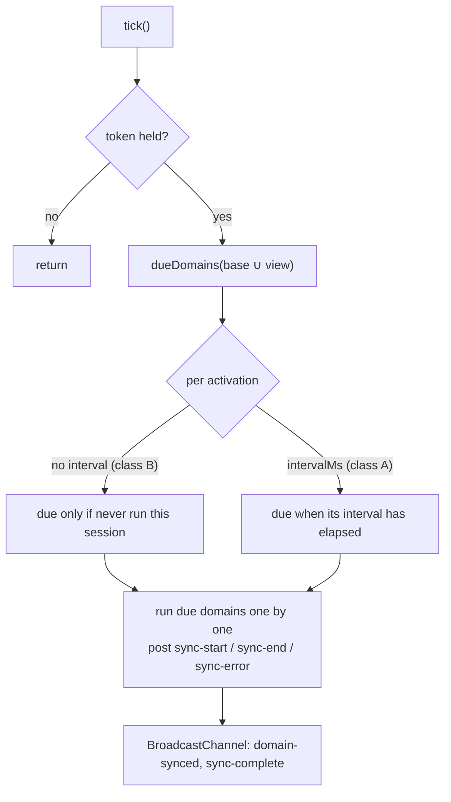
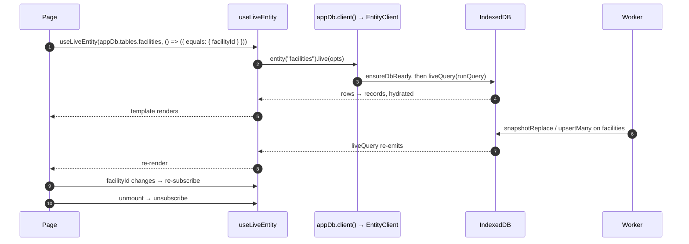
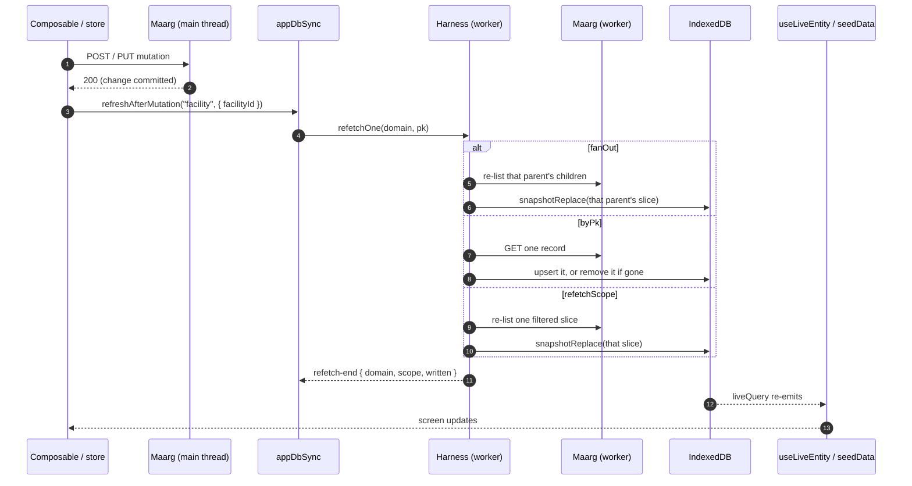
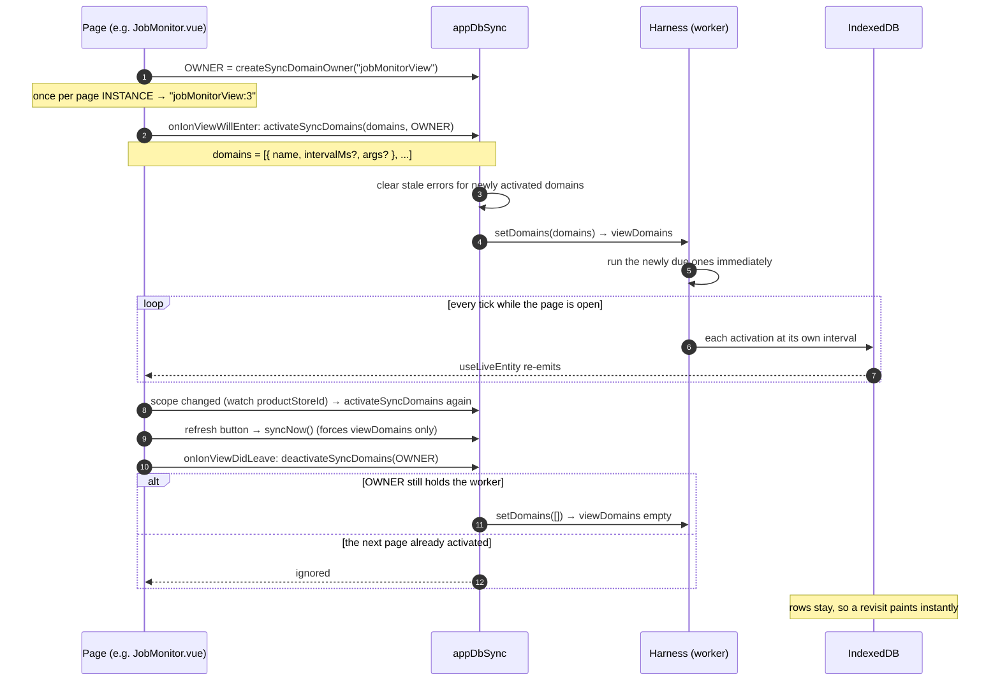
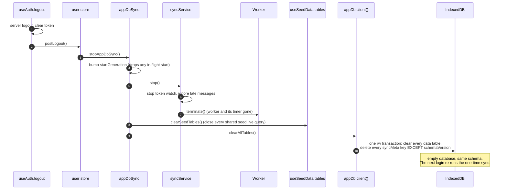

# AccxUI Local Database — Sync Flows

**Version:** 2.1 · **Date:** 2026-10-13

What happens to the APP's local database over a session: boot, login and database construction,
the one-time domain sync, the worker tick, reading data, mutation refresh, page-level sync, and
logout. The structure these flows run on (the access layer over Dexie, schema preparation, domains,
sync runtime) is in [APP_DB_ARCHITECTURE.md](APP_DB_ARCHITECTURE.md). Recipes:
[APP_DB_DEVELOPER_GUIDE.md](APP_DB_DEVELOPER_GUIDE.md).

Names: `appDb` (`src/db/appDb.ts`), database `{oms}-AppDB`, `appDbSync`
(`src/services/appDbSync.ts`), worker `src/workers/appSync.worker.ts`.

| # | Flow |
|---|---|
| 1 | [Boot: modules load, nothing opens](#1-boot-modules-load-nothing-opens) |
| 2 | [Login: database construction and one-time sync](#2-login-database-construction-and-one-time-sync) |
| 3 | [The worker tick](#3-the-worker-tick) |
| 4 | [Reading data back](#4-reading-data-back) |
| 5 | [Mutation → refresh → screen updates](#5-mutation--refresh--screen-updates) |
| 6 | [Page-level sync](#6-page-level-sync) |
| 7 | [Logout and teardown](#7-logout-and-teardown) |

---

## 1. Boot: modules load, nothing opens

The resolver is registered in `main.ts`, not in `appDb.ts`, so `commonUtil` stays out of the worker
bundle. On a page reload with a live session, the `isAuthenticated` watcher starts the sync
directly (§2.2), without going through `postLogin`.

---

## 2. Login: database construction and one-time sync

### 2.1 What login does

### 2.2 How the database is constructed and the sync starts

### 2.3 The one-time domain sync

The first tick finds every class-B domain due, and runs them one at a time:

"Once per login" is the `loginSync:{domain}` marker in `syncMeta`. Later ticks skip a domain that
has it. A class-B domain runs again only when:

- a mutation asks for it (§5),
- the status card's **Refresh** (`resyncDomain`) or **Refresh all** (`resyncReferenceData`) clears
  the marker, or
- the next login, which starts from an empty database.

A domain that failed or wrote nothing is not marked; the harness retries it after 30 s.

---

## 3. The worker tick

One timer in the worker, every 5 s. Two domain sets:

- **`baseDomains`** (login set): every registered class-B domain, set by `start()`.
- **`viewDomains`** (page set): what the open page activated (§6), set by `setDomains()`.

- A class-A pass fetches rows newer than the newest stored one and **upserts**; it never prunes.
- A `401` is posted as `auth-error`; the main thread pushes the latest token straight away.
- Manual passes: `syncNow()` forces the page set; `resyncReferenceData()` clears every marker and
  forces both sets; `resyncDomain(name)` forces one domain.

---

## 4. Reading data back

Every worker write lands in IndexedDB; Dexie notices and re-runs every live query that read that
table, so screens update without any message from the worker.

| Need | Use | Re-renders? |
|---|---|---|
| Rows on screen | `useLiveEntity(appDb.tables.x, opts)` | yes |
| A value now, or a write | `appDb.entity(appDb.tables.x).get / query / …` | no |
| Seed labels and lists | `useSeedData()` / `seedData` (shared live query per seed table) | yes |

Use `hydrated` (or `.withSync()` on seed lists) to tell "not loaded yet" from "really empty".

---

## 5. Mutation → refresh → screen updates

The server is the source of truth. APP code never writes the server's response into a table itself:
it sends the mutation, then asks the worker to re-read the affected record.

- `refreshAfterMutation` takes a **domain name**, not a table name. `resyncDomain(name)`
  re-snapshots the whole domain.
- A failure throws `CacheReconciliationError` (`mutationCommitted = true`): the server write already
  succeeded, so **warn, don't retry the mutation**.
- A refetch and a scheduled sync of the same domain never interleave: the worker queues them.

---

## 6. Page-level sync

Class-A data (logs, job runs, sync histories) is polled **only while a page that shows it is
open**, with that page's arguments and cadence.

- **One page set.** Activating replaces the previous page's set; the login set keeps running
  alongside. Two features on one page compose a single list and activate it once.
- **Why owners.** Ionic fires the old page's `didLeave` *after* the new page's `willEnter`; the
  owner check stops the old page from wiping the new page's domains.
- **Deep link before the worker exists.** The activation is held and sent ahead of `start()`.
- **Page state:** `syncDomainsReady`, `syncDomainsError` (errors of the activated domains only),
  `serviceState.syncedAt[domain]` ("has *my* domain finished a pass yet?").

---

## 7. Logout and teardown

`stopAppDbSync()` is the only teardown. It runs on **logout** (`postLogout`) and at the **start of
every login** (`postLogin`), because a session can end silently (closed tab, sleeping laptop)
without a logout.

- `schemaVersion` survives so the next login's worker does not take the emptied database for an old
  build and rebuild it under rows the main thread has just written.
- A wipe failure is logged and never blocks logout.
- The open page's `useLiveEntity` subscriptions simply re-emit empty; they close on unmount.
- **OMS instance switch:** the resolver returns a new instance, so the next `client()` call opens
  `{newOms}-AppDB` and closes the old handle. The late-binding client follows automatically.
